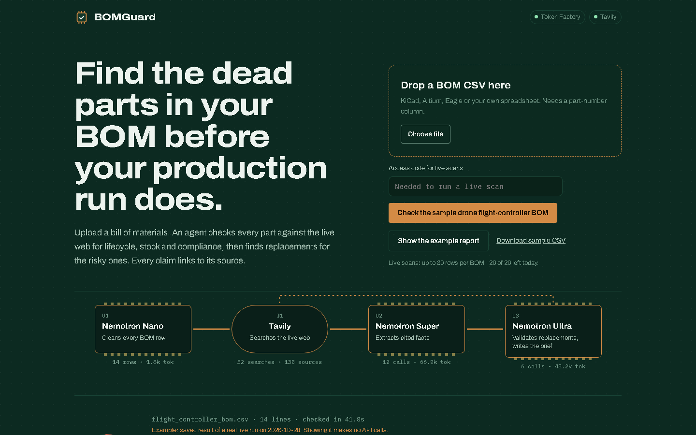
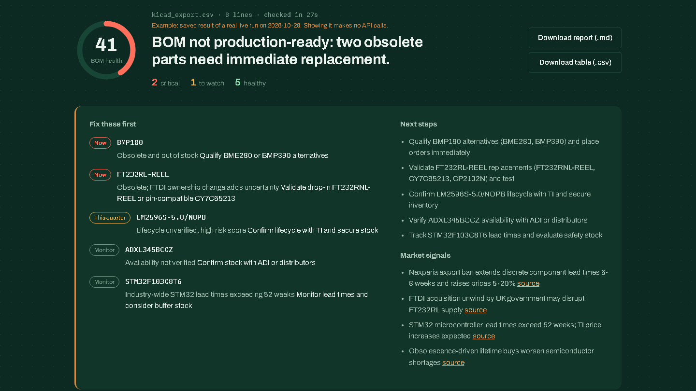
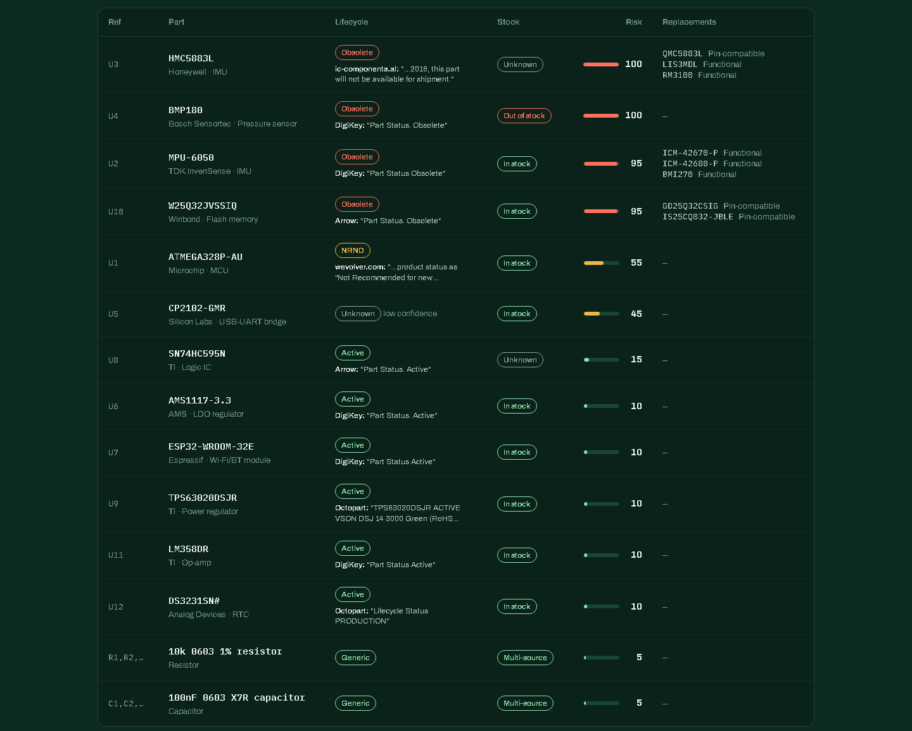
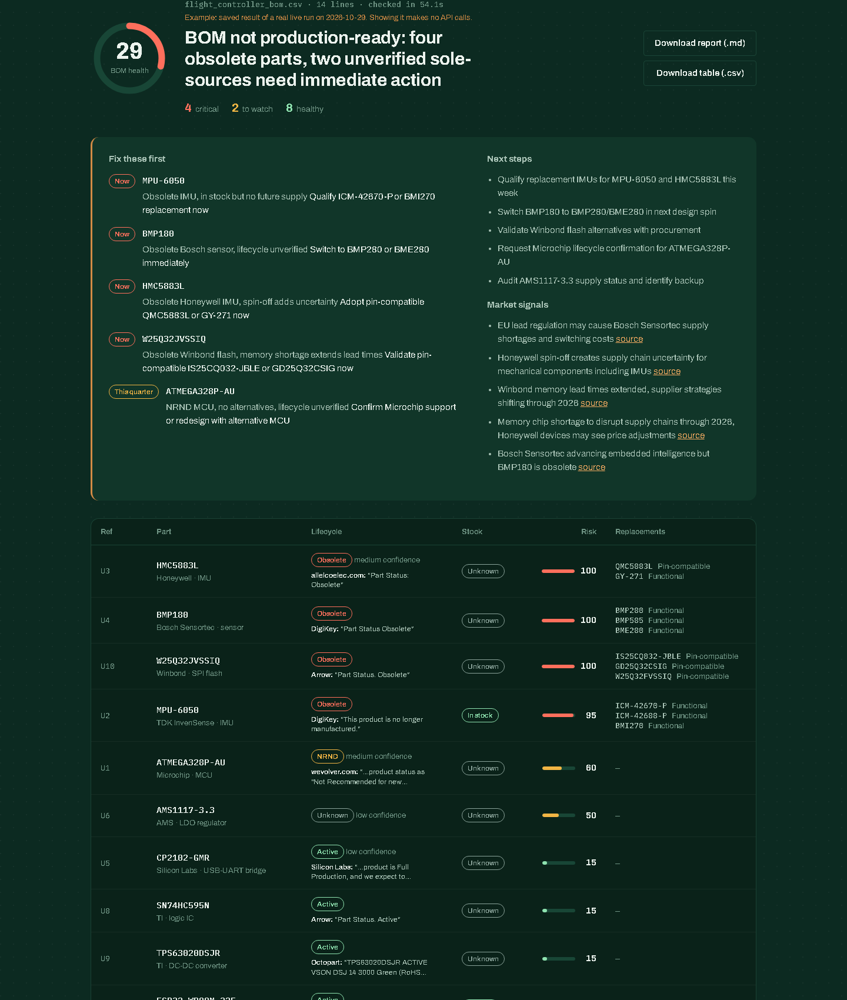
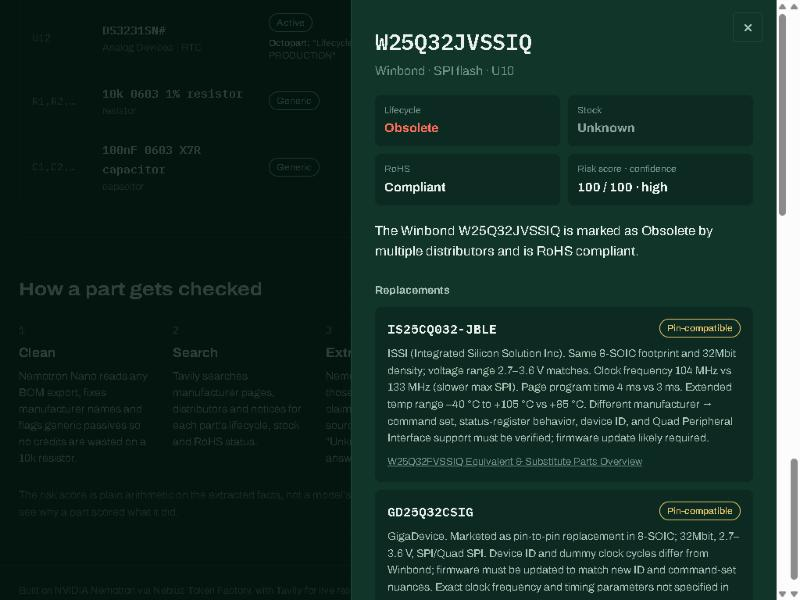

# BOMGuard

**Find the dead parts in your bill of materials before your production run does.**

**Demo video:** https://youtu.be/VTbszSwXgOg

[](LICENSE)

**Live demo:** https://bomguard.onrender.com · **[Open the example report instantly](https://bomguard.onrender.com/?example)**

Upload a BOM CSV. An agent checks every part against the live web for lifecycle, stock and RoHS status, finds replacements for the risky ones, and writes a briefing on what to fix first. Every claim links to the page it came from, and the main table shows the quote behind each verdict.

Built for the Nebius x NVIDIA Global AI Hackathon (Best Apps and Agents track), on NVIDIA Nemotron via Nebius Token Factory, with Tavily for live research.



> The home page opens on a saved report from a real live run, so judges see the full result instantly and it costs nothing to show. Live scans on the public demo need an access code (ask me, or run it yourself with your own keys, below) and are capped at 30 rows per BOM and 20 scans a day. The free instance sleeps when idle, so the first visit can take about 50 seconds to wake up; a live scan of the sample BOM takes 30–60 seconds.

## How to test

1. Open **https://bomguard.onrender.com**. It opens on a saved report from a real live run, so you can explore it straight away (click any part for its sources). The first visit may take about 50 seconds while the free instance wakes up.
2. To run a live scan, enter the access code **`[ACCESS CODE]`** above the copper button.
3. Click **Check the sample drone flight-controller BOM**, or drop in one of the files from [`samples/demo/`](samples/demo) (KiCad, Eagle and a hand-made list). A scan takes 20–60 seconds.

## The problem

A hardware product is built from 50–300 parts. If one of them goes end-of-life or out of stock after the design is frozen, the team faces a board respin, a delayed launch and broker prices with counterfeit risk. Large companies pay for enterprise component-intelligence tools. Startups, small manufacturers and student teams check distributor pages by hand, one part at a time, and still miss things.

BOMGuard does that check in about a minute, for the whole BOM, with sources.

## What it finds

A real live run on `samples/demo/kicad_export.csv`, an unedited KiCad BOM export (27 seconds):



| Part | Result | Evidence shown in the table |
|---|---|---|
| BMP180 (pressure sensor) | **Obsolete**, out of stock; alternatives BME280, BMP390 | DigiKey: "Part Status Obsolete" |
| FT232RL-REEL (USB-UART) | **Obsolete**; FT232RNL-REEL suggested as drop-in | DigiKey: "FT232RL-REEL is Obsolete and no longer manufactured."; Octopart agrees |
| LM2596S-5.0/NOPB (regulator) | **Unknown**, low confidence | Only one datasheet-mirror page gave a status, so it is not trusted |
| STM32F103C8T6, ADXL345BCCZ, MCP2515 | Active | Arrow / DigiKey "Part Status" fields |
| 100nF, 10k | Generic, skipped | No searches spent on passives |



Click any row to see every claim with its source link, the replacements with what an engineer must check, and every page that was read.

The other demo files show the same behaviour: the Eagle export (semicolon-separated) flags MPU-6050 and HMC5883L as obsolete, and the hand-made part list with no manufacturer column checks out as active. Across every run we have done, MPU-6050, BMP180, HMC5883L and W25Q32JVSSIQ come back obsolete and critical. Parts close to the line, where distributor pages lag behind the manufacturer or disagree with each other, can differ between runs; BOMGuard shows that with a lower confidence label and the source behind each verdict, instead of hiding it.

## Screenshots

**Results page:** BOM health, the "fix these first" briefing, and every part with the verified quote behind its verdict.



**Part details drawer:** click any part to see its facts, replacements with what an engineer must check, and every source link.



## How it works

```
BOM CSV ─▶ Nemotron Nano ─▶ Tavily search ─▶ Nemotron Super ─▶ verify + score ─▶ (risky?) Tavily ─▶ Nemotron Ultra ─▶ briefing
          clean rows         live web per part   cited facts       in plain code         find successors   judge fit, write brief
```

| Step | Model / tool | Why this tier |
|---|---|---|
| Clean the BOM | **Nemotron 3 Nano** (`nvidia/NVIDIA-Nemotron-3-Nano-30B-A3B`) | One cheap, fast call per 40 rows. Normalizes manufacturer names, assigns categories, and flags generic passives so no searches are wasted on a 10k resistor. |
| Research each part | **Tavily** advanced search | Two parallel searches per part: distributor product pages (DigiKey, Mouser, Octopart, Arrow, LCSC, Farnell…) and EOL/NRND/PCN notices. |
| Extract facts | **Nemotron 3 Super** (`nvidia/nemotron-3-super-120b-a12b`) | Many parallel calls that need careful reading of messy web text. Every fact must come with an exact quote and the index of the source it came from. |
| Find replacements | **Tavily** + **Nemotron 3 Ultra** (`nvidia/Nemotron-3-Ultra-550b-a55b`) | Only for parts scoring 50+. Ultra judges each candidate as drop-in, pin-compatible or functional (PCB change) and lists what an engineer must check. |
| Briefing | **Tavily news** + **Nemotron 3 Ultra** | Recent supply-chain news for the riskiest vendors, plus a prioritized action list. |

### Why you can trust the results

A wrong "Obsolete" in front of an engineer is worse than an honest "Unknown". So the model reports facts with quotes, and plain code decides what survives (`app/agent.py`):

- **The quote must really be on the page.** A claim is kept only if its source was actually retrieved, mentions this part family, and contains the quoted text.
- **Datasheet legends are not evidence.** TI datasheets define every status code ("NRND: Not recommended for new designs…"). Quoting that definition says nothing about this part, so it is filtered out, with or without its label.
- **The quotes overrule the model.** If the model says NRND but its only verified quote says "Part Status: Active", the answer is Active.
- **Better sources win.** A quote from the manufacturer's own site decides. Distributor status fields can lag behind the manufacturer (DigiKey still lists the ATmega328P as Active; Microchip says NRND), so without a manufacturer quote, any Active-vs-at-risk disagreement becomes **Unknown, sources disagree**.
- **Secondary sources count for less.** If only blogs or broker pages back a verdict (not a manufacturer page or a distributor status field), confidence drops to medium when two or more sites agree, and low when only one does.
- **The score is arithmetic, not opinion.** Risk = lifecycle points + stock points + RoHS points (`score()`), so every number can be explained. Unknown always lands in "to watch", never "healthy".
- **Replacements must appear in the sources.** Ultra may not invent part numbers, and package or reel variants of the same chip are filtered out.
- **Untrusted text stays text.** Everything from the web or a model is escaped before it reaches the page.

The UI shows live usage per Nemotron tier (calls, tokens) and Tavily searches and sources, streamed over Server-Sent Events as each part finishes.

## How Nebius Token Factory and NVIDIA Nemotron are used

All model calls go through Token Factory's OpenAI-compatible endpoint, so one client serves three Nemotron sizes, each matched to its job: Nano for bulk cleanup, Super for many parallel extractions, Ultra only where judgment matters (replacements and the briefing). On the sample BOM a run uses 19 calls and about 117k tokens. Parts are researched in parallel (`CONCURRENCY`, default 6).

## Run it

Requires Python 3.11+.

```bash
git clone https://github.com/kalpeshmahajan21/bomguard && cd bomguard
python -m venv .venv && source .venv/bin/activate   # Windows: .venv\Scripts\activate
pip install -r requirements.txt
cp .env.example .env        # then paste your NEBIUS_API_KEY and TAVILY_API_KEY
python scripts/check_setup.py   # checks keys and lists the Nemotron IDs on your account
uvicorn app.main:app --reload
```

Open http://localhost:8000 and click **Check the sample drone flight-controller BOM**, or drop in your own CSV. On Windows, `run.bat` does the setup and start in one step.

No keys yet? `MOCK=1 uvicorn app.main:app` runs the full UI with clearly labelled demo data.

### BOM format

Any CSV with a header row and a part-number column. Recognized headers include `MPN`, `Manufacturer Part Number`, `Mfr Part #`, `Manufacturer`, `Description`/`Value`, `Qty`, `Designator`/`Reference`. KiCad, Altium and Eagle exports work as-is.

### Deploy

`render.yaml` deploys to [Render](https://render.com) as a Docker web service: create a Blueprint from this repo and paste your two API keys.

Spend guards for a public deploy, all checked on the server before any paid call:

| Setting | Default | Effect |
|---|---|---|
| `DEMO_ACCESS_CODE` | empty | When set, live scans need this code. On Render, live scans stay **off** until it is set, so a forgotten setting can't burn credits. |
| `MAX_ROWS` | 30 | Rows checked per BOM; extra rows are skipped and the UI says so. |
| `DAILY_SCAN_LIMIT` | 20 | Live scans per UTC day. Each upload can be analyzed once. |

The saved example report (`/api/example`) never calls a model or search API.

Or with Docker anywhere:

```bash
docker build -t bomguard . && docker run -p 8000:8000 --env-file .env bomguard
```

Sessions and the daily scan counter are kept in memory, so run a single instance (a restart resets the counter).

## Limitations

- **Results depend on what the web search returns.** If the manufacturer's page isn't among the results, BOMGuard relies on distributors, which can lag. When they disagree it says so instead of guessing.
- Some evidence comes from secondary sites (blogs, parts brokers). The site name is shown next to every quote so you can judge it.
- Stock is a snapshot from distributor pages, not a live inventory feed.

## Project layout

```
app/main.py       FastAPI routes, SSE stream, example report, CSV/Markdown export
app/bom.py        CSV parsing, header detection, Nemotron Nano normalization
app/agent.py      per-part pipeline, claim verification, lifecycle rules, scoring, Ultra alternatives + briefing
app/research.py   Tavily search wrappers with disk cache
app/llm.py        Token Factory client, JSON extraction, per-tier usage counters
app/mock.py       demo-data mode for UI work without keys
static/           front end (vanilla HTML/CSS/JS)
samples/          sample BOM, saved live run (example_report.json), demo/ exports (KiCad, Eagle, hand-made)
render.yaml       one-click Render deploy
```

## Roadmap

- Search each manufacturer's own site per part, so the strongest evidence is always in the sources
- Scheduled re-scans of released BOMs with Nebius Serverless Jobs, with alerts when a part's status changes
- Direct KiCad/Altium plugin
- Cross-checking stock and price across distributors

## License

[MIT](LICENSE)
